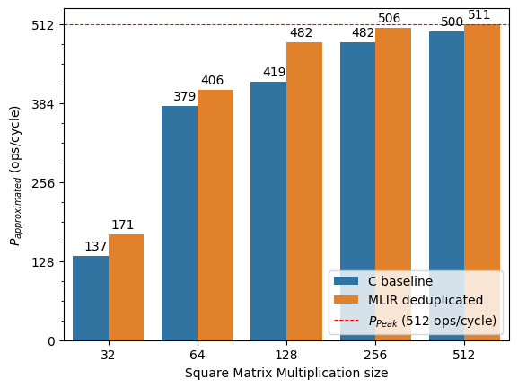
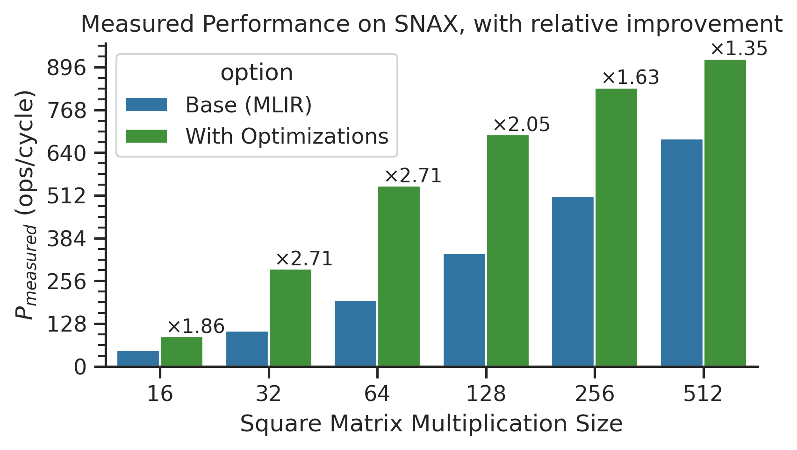
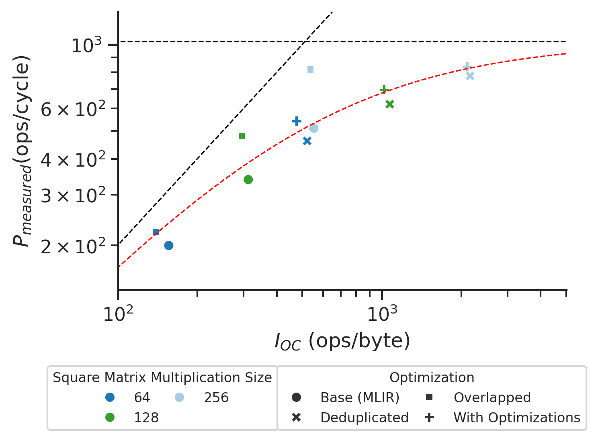

# 06 Figure 10–12 复现

**PASS：三张图均由本次官方运行数据真实生成，已打开检查；没有复制论文图片或预置结果。**
原始数据、日志与创建时间关联见 `configs/experiment_run.json`。

| 论文图 | 原始输出 | 报告归档 | 本次图像大小 |
| --- | --- | --- | --- |
| Figure 10 / Gemmini | `artifacts/fig10_bar_plot.png` | `figures/fig10_bar_plot.png` | 28615 字节 |
| Figure 11 / OpenGeMM | `artifacts/fig_11_bar_plot.png` | `figures/fig_11_bar_plot.png` | 139642 字节 |
| Figure 12 / Configuration Roofline | `artifacts/fig_12_roofline.png` | `figures/fig_12_roofline.png` | 128625 字节 |

README 单独绘图命令将 Gemmini 文件名写为 `fig_10_bar_plot.png`，
实际完整入口为 `fig10_bar_plot.png`；保留真实名称，两者不表示不同实验。
归档副本与原始输出的 SHA-256 相同。

## Figure 10

五种规模 32–512，baseline / optimized 模型性能依次为
137/171、379/406、419/482、482/506、500/511 ops/cycle。
使用作者 Spike 区间计数、假设 CPI=3 和峰值 512 ops/cycle。
这是近似模型结果，不是硬件测量。

## Figure 11

六种规模 16–512，图上组合优化加速比取整显示
1.86、2.71、2.71、2.05、1.63、1.35 倍，与本次底层数据及论文标注精度一致。
完整实验还包含独立去重和独立重叠模式，均保留在 24 行 CSV 中。

## Figure 12

按作者绘图脚本选择 64、128、256 三种规模及四种模式，共 12 个点。
横轴为 Ioc (ops/byte)，纵轴为仿真性能 (ops/cycle)；
顺序和并发配置 roofline 使用原公式，峰值 1024 ops/cycle、带宽 2 bytes/cycle。
去重向右移动、重叠提高性能的定性关系由实际点位支持。

## 验收边界

数值来自当前 PKL 并与精确 README 表格逐项核对；未从柱高或图片中伪造更多精确论文值。
**NOT TESTED**：与 PDF 的像素级相等、真实芯片性能及论文实验范围之外的泛化。
字体、标题、图例布局沿用项目代码，排版差异不作为数值误差。
