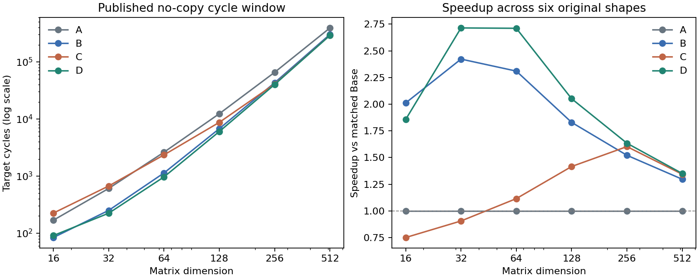
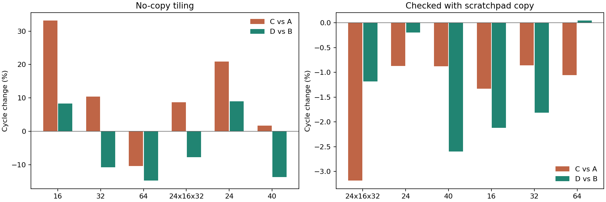

# 周期退化与原因

原 24 点独立复核。A→D 六格均快，几何平均 **1.98875×**，最好 **2.71429×**。单开 C 平均 **1.1502×**，**2/6** 格退化。[分布表](data/runtime_summary.csv)

| 原方阵 N | A | B | C | D |
|---:|---:|---:|---:|---:|
| 16 | 169 | 84 | 225 | 91 |
| 32 | 608 | 251 | 671 | 224 |
| 64 | 2624 | 1136 | 2352 | 968 |
| 128 | 12380 | 6767 | 8741 | 6036 |
| 256 | 65692 | 43183 | 40990 | 40196 |
| 512 | 393488 | 303398 | 292877 | 291302 |

**CONFIRMED REGRESSION，原图可见，附新的原因证据。** N16 A→C 多 56 周期（+33.136%），N32 多 63（+10.362%）。launch/await 均为原 4/4、16/16；配置-only 写 **100→150、400→500**，动态指令 **129→179、531→631**。在最终 streamer launch 后 C 还各有 25 写，A 为 0。实际代码每个内层循环首 setup 前置，体内提前配置下一轮，额外 25×2/4 对应各外层分块，最后一次值可观察时需要保留合法状态。固定管线只切换 Overlap，增加的写可定位到流水首尾；整段周期还受取指、等待相位等影响。[原 Overlap 代码](https://github.com/KULeuven-MICAS/snax-mlir/blob/0df8b515768232036bceb6af7a6d5935b5e1a3db/compiler/transforms/accfg_config_overlap.py) · [尾写验证](07_correctness_and_boundary_cases.md)

**新增范围反转。** 24³、24×16×32、40³ no-copy 的 A→C 分别 **350→423、481→523、961→977**，约 +20.86%、+8.73%、+1.66%。匹配 checked 三形状为 **5283→5237、5273→5105、21918→21725**，三个方向全部反转。原 N16 B→D **84→91**，新 24³ **145→158**；P1 读回的原方法 checked 64³ 为 **83424→83460**，约 +0.043%，仅一格。构建失败没有周期。[全样本](data/opengemm_cases.csv) · [数值退化](data/regression_cases.csv)

Gemmini 旧 C/MLIR N32/64/128 的 Spike 指令计数是 117/120/607→85/89/167。匹配管线则是 **85→85、89→89、171→167**，区间 RoCC **11→11、11→11、29→25**。N128 少 4/171 即 **2.34%** 指令计数，设备周期未测。没有把原不同 C/MLIR 的全部差距归因给去重。[Gemmini 匹配样本](data/gemmini_cases.csv)

按几何平均，新增三形状 A→D no-copy **2.630×**、checked **1.054×**。原六形状 A→D 最差仍为 512³ 的 **1.351×**。B→D 最差为新 24³ no-copy 的 **0.918×**（慢 **8.97%**）。既有缩减图依图类型汇总，attention seed 37 是唯一 Both 对 Dedup 退化点（**+0.726%**），该窗包含主机中间算子。[按形状](data/runtime_summary.csv) · [按图](data/prior_graph_runtime_summary.csv)

几何平均按各范围实测尺寸或种子等权。没有把同 ELF 波形重放当成随机尾延迟，也没有用 3–6 个尺寸估计 P95/P99。

