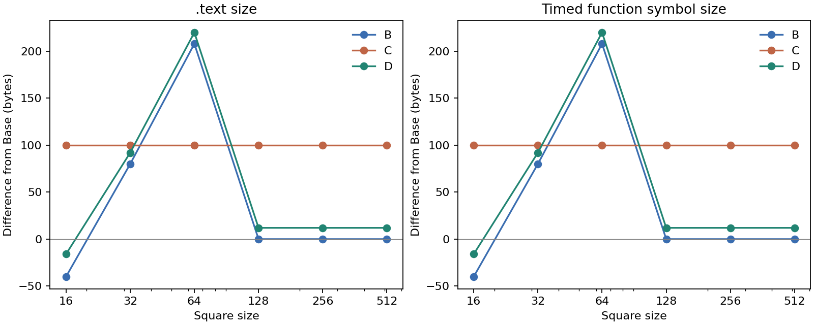
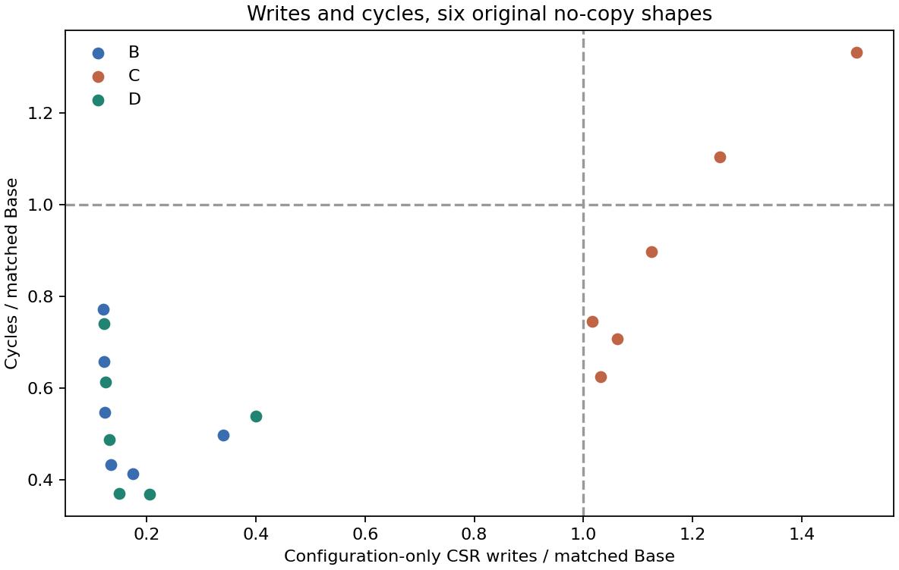

# 代码、指令与 ABI 开销

逐个 ELF 按 .text、.rodata、.data、可执行 PT_LOAD、debug 与总文件大小分开统计。导出 streamer_matmul 及 pinned 和 C ABI 包装符号，计时核 streamer_matmul_pinned_1 的符号大小与静态 32 位指令独立计数。节点可追到原 ELF SHA 与隔离反汇编。没有用包含调试数据的 ELF 文件长度估计 I-cache 行为。[全部静态与动态指标](data/opengemm_cases.csv)

| 同流水线对照 | 变化 |
|---|---|
| 原 C 对 A | 原 6/6 的 .text 均 +100B。64/128/256/512 周期下降，却都增加主机指令及纯配置写。64³ .text **11320→11420B**，核 **268→368B**，主机 **2084→2284**，周期 **2624→2352**。 |
| 原 B 对 D | .text N16 +24B，其余各 +12B。原 5/6 D 周期更少。64³ **1136→968 cycles**，纯配置写 **214→238**。N16 增量亦伴随变慢。 |
| 原 32³ A 对 B | 去重写 **400→70**、周期 **608→251**，.text **11316→11396B**。固化管线只切换去重，字节变化仍包含后端指令选择与布局。 |
| 新矩形 no-copy A 对 C | .text **11612→11436B**，配置写 **300→375**。静态体积与动态配置并不单调。 |

逐条解码机器码并对齐运行 PC 后，原六尺寸 A→C 的计时核都净增 **25 条静态配置写，即 100B**，等于各自的 .text 净增。首个 streamer launch 前 A/C 都执行覆盖 100B 的配置指令。最后一次 streamer launch 后，A 覆盖 0B，C 覆盖 100B，B 覆盖 0B，D 覆盖 12B。此处按唯一 PC 计字节。C 的末尾块也用于循环内的下一趟提前写，字节量不能再与整核相加。N16 末次 launch 后动态执行 **7→32** 条，N32–512 为 **8→33**。[原六尺寸首尾足迹](data/loop_boundary_footprints.csv)

原 16³ A/C 计时核栈都为 16B、ABI save/restore 4 对、测量区间 stack 访存为 0。矩形 checked A/C 都为 48B，C 的匹配保存恢复 **9→11** 对；B/D 各 32B、6 对。这是 callee-saved 事务的直接证据，未取得分配器活跃区间和临时 spill provenance。没有从普通 load/store 推出寄存器溢出。

配置 CSR 指令按 RV32 编码计每条 4 bytes，仅反映动态 ISA 指令编码足迹。论文的 Gemmini 16B 采用两个 64 位 RoCC 操作数容量。总线的真实应用级配置字节另标 NOT MEASURED。

