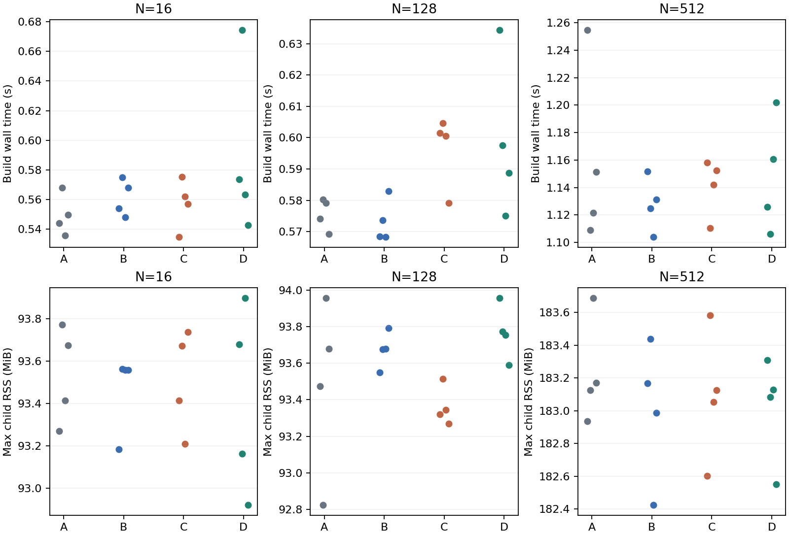

# 编译时间、内存与 IR 结构

按 ABCD、BCDA、CDAB、DABC 顺序，对 N16/128/512 进行 **48 次**新 Make 构建。输入生成好后，从 make -j1 启动计时到 ELF 返回，包含工具初始化、文件 I/O、IR、后端和链接，排除数据生成、Docker 启动、模拟。每次移除隔离目录的生成文件，未销毁原产物。首次观测与顺序保留，OS 缓存没有刻意清空。RSS 是容器里 RUSAGE_CHILDREN.ru_maxrss，记录被等待进程的最大 RSS，不是 WSL/容器进程总量。[顺序样本](data/build_samples.csv)

| N | A 中位 s | B | C | D | A/D 中位 RSS KiB |
|---:|---:|---:|---:|---:|---:|
| 16 | 0.547 | 0.561 | 0.560 | 0.569 | 95790 / 95664 |
| 128 | 0.576 | 0.571 | 0.601 | 0.594 | 95822 / 96014 |
| 512 | 1.136 | 1.128 | 1.148 | 1.143 | 187544 / 187500 |

以上是显示约数，精确中位和区间见 CSV。D 的 wall 中位有所增加，但同模式波动可覆盖这种量级，RSS 方向随规模而变。暂无跨规模稳健的全编译时间或 peak RSS 大幅退化。另在 N16 使用 native Make 规则记录每方法三次 LLVM 后端（CSR IR 到目标 .o）及最终单命令链接，进程内 point timings 与这些阶段不重复相加。[构建摘要](data/build_summary.csv) · [后端和链接](data/backend_samples.csv)

冻结的 xDSL 进程内每组九次，共 648 条逐阶段样本，解析单列。ACCFG 构造、状态 weaving、去重、重叠及 CSR lowering 逐段计时，排除 context 初始化、解析、打印和文件 I/O。最终 IR 验证结构等价于正常 Make。N16 构造中位 **0.71–0.74 ms**，状态 weaving **0.62–0.63 ms**，去重 **2.17–2.23 ms**，重叠 **0.80–0.96 ms**。A/B/C/D lowering 后操作数 **158/158/218/174**。首轮 pass 准备因 Make 移除临时 IR 返回失败，重建相同中间 IR 后 12/12 通过。全构建数据始终有效。[pass 样本](data/pass_samples.csv) · [中位与 IR 体积](data/pass_summary.csv)

结构压力实验复制 1/8/32 个真实函数体组，不增加循环深度；分支和循环数量都从 2 扩到 64。32 份时 A→D **3140→3396** 操作，tracemalloc 峰值 **4.81→6.11 MB**，进程 RSS **54296→58240 KiB**。这是装有仪器的宿主侧 Python 内存证据，不能代替原模型编译内存或同一进程无仪器时间。[扩展明细](data/structure_stress.csv)

