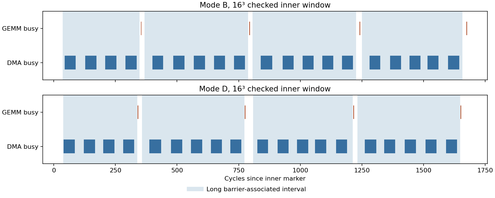

# DMA、同步与测量范围

原 16³ no-copy B/D 为 **84/91**；保留的原方法 checked B/D 为 **1700/1664**，方向反转。新的 A–D 共用 C 标记脚本将 tiling 内层再包一对 mcycle。outer 从调用前至 cluster barrier 后，排除描述符初始化和 golden。加标记会扰动绝对周期，所有 outer 比较限于同 harness。[计时边界](02_fair_baseline_design.md)

| 新 16³ checked 同标记 | B Dedup | D Both | D−B |
|---|---:|---:|---:|
| 内层 cycles | 1695 | 1669 | −26 |
| 外层 cycles | 2449 | 2445 | −4 |
| 四段长 barrier 邻近区间 | 1550 | 1526 | −24 |
| 长段内的 DMA busy | 853 | 857 | +4 |
| 长段内的 DMA 非 busy | 697 | 669 | −28 |
| 长段外 | 145 | 143 | −2 |
| 内层 DMA 提交 / GEMM busy | 19 / 12 | 19 / 12 | 相同 |

B 的配置写 **34** 少于 D 的 **40**，而 B 的等待区间和内、外层周期都更多。基于 VCD 的忙闲分解揭示差异在哪，无法唯一定位银行冲突、取指相位、软件提交或其它资源。四段为 hart0 barrier CSR 至下一条指令的 ≥100 cycles 间隔。两 ELF 各自开关波形，内层 JSON 和外层 mcycle 一致。另以原 ELF 各重跑一次，保存未筛选 VCD 压缩件，筛选信号及双 hart JSON 与首次波形逐字一致。[波形和软件事件](data/dma_events.csv) · [明细](data/dma_summary.csv) · [波形归档](manifests/archive.json)

只读复核门控分支的原 A/B/C 缩减图。attention seed 37 中 B **6608**，Both **6656**，相反同布局跨 await 的控制仅差 3 cycles。图中输入与权重打包约 2900，主机中间算子约 2250–4400 cycles，无 timed DMA。基于标记区分打包、配置到 launch、加速器边界、host middle 和最终输出，后者从最后 await 至计时结束。该范围仍是图内，未取得实际部署的装载、框架调度或板级延迟。[缩减图阶段表](data/prior_graph_phases.csv) · [按图和种子汇总](data/prior_graph_runtime_summary.csv)

