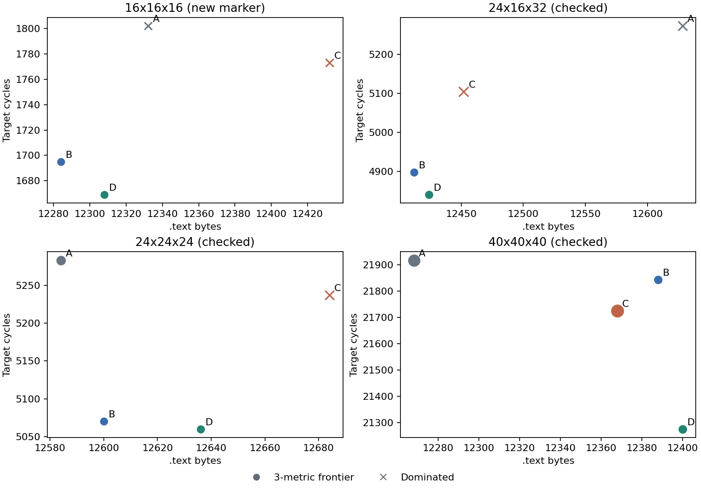

# 多指标、Pareto 和指标方向

统一表先明确定义指标方向。运行 cycles、执行指令、配置写、代码、编译秒数和 RSS 越低越好，Gemmini 可达吞吐 MODEL 越高越好。DMA busy 只表示占用时间。逻辑编码字节和设备物理字节分列。能量、功率、芯片面积、频率及总线字节未测。[统一多指标表](data/multi_metric_comparison.csv)

Pareto 仅比较同形、同窗口、数值 golden PASS，且所有四个方法都有的三个指标 **内层 cycles、.text 字节和配置-only CSR 写**。各维不劣且至少一维更低才支配。当前编译时间与内存的主对照为 no-copy，不拿来充当 checked 点的额外指标；DMA 也只测了两法。边界失败和历史 no-copy 数值未检的样本不进入前沿。

| 检查范围 | 前沿 | 解释 |
|---|---|---|
| 16³ 新标记 checked | B、D | D 快 26，B 少 6 写、少 24B；A/C 被支配 |
| 24×16×32 checked | B、D | D 快 58，B 少 9 写、少 12B；A/C 被支配 |
| 24³ checked | A、B、D | A 代码最小，B 写最少，D 周期最低；C 被支配 |
| 40³ checked | A、B、C、D | 每个都有独立取舍。C 对 B 周期和代码更低但写更多；D 最快且写少于 C，但代码最大。 |

大尺寸 C 减时间、增配置/指令与代码的权衡已确认；B 到 D 多个 checked 点以写次数与代码换周期。IR 膨胀和压力测试内存的确增加，但真实完整构建未给出普遍的大幅退化。未从固定策略的不同综合指标选择推断全局最优。

[前沿结果与支配者](data/pareto_comparison.csv) · [逐维负向变化](data/regression_cases.csv)
