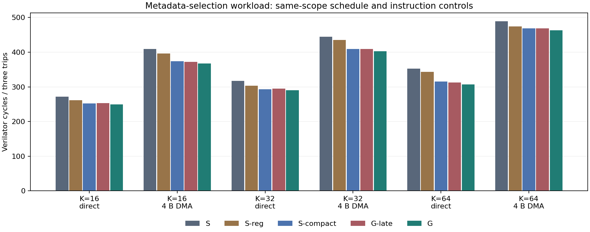
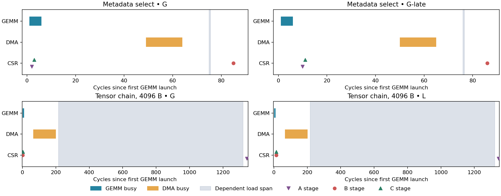

# 提前配置的因果消融

原 S/G 的 K16/32/64、direct/4 B DMA 六组重放使用原始 ELF，重现 **1.10133×** 几何平均加速与每三趟 **18** 条 hart0 指令差。各法相同配置写数、同一次数 launch/await。下表均以 cycles 为单位，正的 Δ 表示提前或精简后更快。[六组配对 CSV](data/causal_p1.csv)

| K | 范围 | S | S-reg | S-compact | G-late | G | G-late−G | S−S-compact | S-compact−G |
|---:|---|---:|---:|---:|---:|---:|---:|---:|---:|
| 16 | Direct | 272 | 261 | 252 | 253 | 249 | 4 | 20 | 3 |
| 16 | DMA | 409 | 396 | 374 | 372 | 367 | 5 | 35 | 7 |
| 32 | Direct | 317 | 303 | 293 | 295 | 290 | 5 | 24 | 3 |
| 32 | DMA | 445 | 435 | 409 | 409 | 403 | 6 | 36 | 6 |
| 64 | Direct | 353 | 343 | 315 | 313 | 307 | 6 | 38 | 8 |
| 64 | DMA | 489 | 474 | 469 | 469 | 463 | 6 | 20 | 6 |

**提前写入独立可观察的收益为 4–6 cycles。** G 与 G-late 在原 ELF 只排列 A/C 写和第一组 await 的五个已有指令字，保留大布局、分支/调用 PC 与目标、寄存器及动态指令多重集。六格的 Δ 合计 32 cycles，原 S−G 直接差的合计为 206。前者衡量的是 G lowering 下这一重排的条件效应；两个和的比例不是可泛化的独立成本份额。对 G-private → G-full-late 的跨调用敏感性检查，K16 的真实节省为 direct 3 和 DMA 7 cycles；调用位置因重排前移，目标保持不变。

**18 条指令的受控干预。** 原 S 每趟有两次保存、两次恢复和两次参数搬运。先使用私有调用寄存器并在原六槽保留 NOP，S-reg 在动态总数保持相等时已快 10–15 cycles。之后删除六个执行槽，S-compact 相对 S-reg 再省 5–28 cycles。S-compact 仍在晚到读之后写 A/B/C，相对原 S 减少 18 条区间指令、实测省 **20–38 cycles**。该值含取消访存/依赖、改变寄存器及压缩后的取指/DMA 相位。纯粹指令条数本身的周期贡献无法从这些干预唯一识别。同样动态条数下，G 相对 S-compact 仍省 **3–8 cycles**，跨基底 ELF 的该比较允许布局差，优先用严格的 G-late 对照归因。

**控制流与同步。** 六组内各对照的动态分支计数保持一致，严格 G-late 的非干预控制流与寄存器未变。S-reg 保持 P1 串行 launch/await 的代码槽；S-compact 改变函数内相位。K16 4 B 的 G 与 G-late 三次软件提交到 idle 均为 52 cycles。VCD 观察 A/C 在 G 首个 GEMM busy 内写入，G-late 在 busy 后。早写引发的软件或资源相位改变属于测得的整条干预效应；它们无法进一步从局部调度效应剥离。原 1.101× 大于只提前写的效应。[动态操作与分支](data/performance.csv) · [双 hart 事件](data/timeline.csv) · [实测阶段分解](data/vcd_phase_summary.csv)

