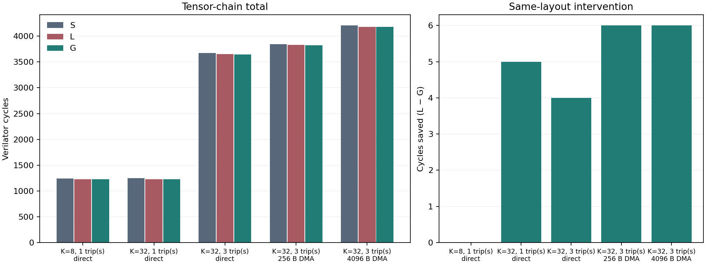

# 独立张量链验证

原 P1 首次 GEMM 的单个输出字只用于选择两个预先填充的 B 地址。新族执行 `GEMM → int32 输出全张量 → 有符号除 3 和饱和到 int8 → 写到 OpenGeMM 行平铺 SPM → 消费 GEMM`。消费者的输入数值本身依赖生产者的全体 64 个结果，晚到字段是 A；B/C 早就绪。加速器仍是同一 OpenGeMM，新增负载为小型端到端微基准。用的是 pinned accfg/CSR lowering 与真实硬件 GEMM，两次 launch 并非改名或 CPU 代算。[张量链及驱动](../../research/p1_ablation_v2/cases/tensor_chain.c) · [IR 模板](../../research/p1_ablation_v2/cases/tensor_chain.mlir.in)

独立 Python 生成第一次 GEMM、量化的中间张量和第二次 GEMM 的完整参考。C 在计时之后逐项检查三者。指令 trace 独立确认消费 helper 读到预期源的全部 64 个不同 word 地址，并且第二次 launch 吃到实际 packed A。K>8 只把 8 列生产者结果用于消费者，其余 K 维按定义零补齐。DMA 模式由 hart1 搬运 256 B 完整结果；4096 B 模式用真实发布缓冲和尾部 sentinel 人为加长 DMA 事务。目标验证全部 64 个输出字和末尾 sentinel，长 DMA 用于应力控制。[快照及源地址证据](data/timeline.csv) · [独立参考与正确性](data/correctness.json)

| 计算与计时范围 | S | G-late | G | S → G | 严格 G-late → G |
|---|---:|---:|---:|---:|---:|
| K8，一趟，direct | 1243 | 1229 | 1229 | 14 | 0 |
| K32，一趟，direct，seed 1 | 1245 | 1230 | 1225 | 20 | 5 |
| K32，三趟，direct，seed 11 | 3675 | 3652 | 3648 | 27 | 4 |
| K32，三趟，256 B DMA | 3843 | 3828 | 3822 | 21 | 6 |
| K32，三趟，4096 B DMA | 4205 | 4183 | 4177 | 28 | 6 |

K8 的官方 whole-overlap 与 S 同为 1243，CSR lowering 字节相同。匹配 L 在 G 的二进制内将 B/C 写越过 await，在调用前执行；固定间接状态、分支 PC、动态操作数和指令多重集。K32 的三趟严格收益为 **0.11%–0.16%**（相对 L），单趟的 5 cycles 约 0.41%。实验确认少量收益跨越了两种真实依赖结构。量化和发布时间占绝大部分，尚无代表性模型端到端吞吐收益的证据。真实长 DMA 中观察到更长 busy，未让早写收益从 6 cycles 扩大。[独立族数据](data/negative_and_cross_family.csv) · [原始信号](data/vcd_events.csv)

