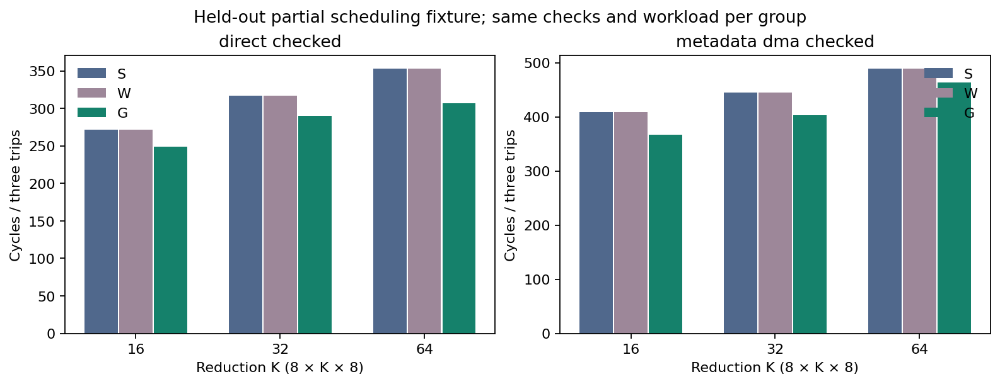
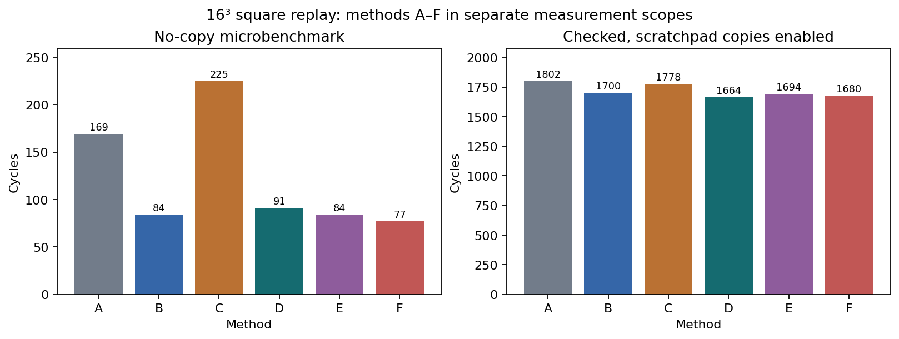
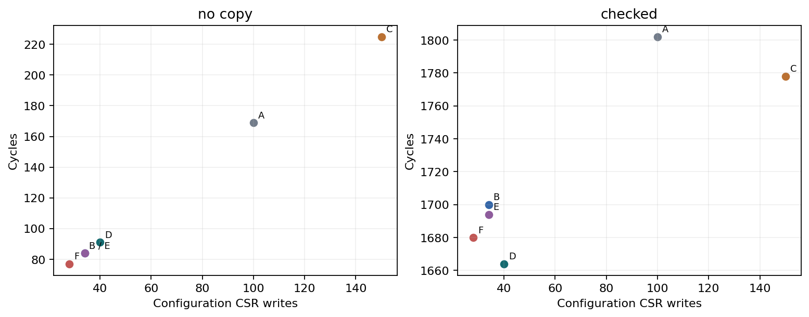

# 性能对比

28 组原方阵对照均在原尺寸、原定时边界复跑。G 的真实数据依赖用独立 8×K×8 fixture 表达，原方阵 G 和新 fixture E/F 为 N/A。下表只比较同一 K、种子、趟数、计时范围和校验方式。两种范围均做完整 golden。direct 不含 metadata DMA，metadata DMA 计入每趟一次 4 字节传输与两次 barrier。两种范围都不计入输入初始化与校验。

| K | 范围 | S / W cycles | G cycles | G 周期减少 | S / W → G hart0 指令 | 配置写 S / W / G |
|---:|---|---:|---:|---:|---:|---|
| 16 | direct | 272 | 249 | 8.46% | 148 → 130 | 18 / 18 / 18 |
| 16 | metadata DMA | 409 | 367 | 10.27% | 172 → 154 | 18 / 18 / 18 |
| 32 | direct | 317 | 290 | 8.52% | 154 → 136 | 18 / 18 / 18 |
| 32 | metadata DMA | 445 | 403 | 9.44% | 178 → 160 | 18 / 18 / 18 |
| 64 | direct | 353 | 307 | 13.03% | 151 → 133 | 18 / 18 / 18 |
| 64 | metadata DMA | 489 | 463 | 5.32% | 175 → 157 | 18 / 18 / 18 |

NEW，三趟，seed 11，单元内两个数值输出和最终状态通过。S 为参考串行；W 为官方 overlap 重跑；该 fixture 的 Base、Dedup、Overlap 和 Both 在 CSR lowering 等价。每行每个候选均有六次 launch、六次 await。G 六单元加速几何平均 **1.1013×**，零趟均 1 cycle；在实际发起 GEMM 的已测 probe 中未出现负收益。K16 seed 3 一趟在直接读取中为 118→116，有 DMA 为 191→172。附加 seed 1 与 11 覆盖两种 B 地址。六个 K16 三趟种子 11 的同 ELF 复跑周期、指令和配置写相同。

G 将两次配置写移入合法窗口，且动态 hart0 指令少 18 条。它同时改变后端寄存器活跃区间和生成指令序列。因而周期差是**完整合法候选相对于匹配参考的效果**，无法将全部收益解释为两次 CSR 各自的重叠。若要估计重叠独立贡献，需要保持静态指令/访存形态的额外重排消融。

ELF 大小 109536–111520 字节，构建计时 622–705 ms（probe）；方阵 127124–168188 字节和 666–1875 ms。计时为一次主机构建记录，包括 xDSL 处理和链接，同 ELF 复跑沿用首次构建时间。它们用于复查异常，样本不支持编译开销的统计比较。K64 两次超时的结果不进入性能比较；三种方法在两个范围都以同一种独立预生成 golden 成功重跑。[运行状态](manifests/run_status.csv)

[逐行完整比较](data/performance_comparison.csv) · [全部 probe 与源码/ELF 哈希](data/partial_comparison.csv) · [方阵复跑](data/new_square_replays.csv)

