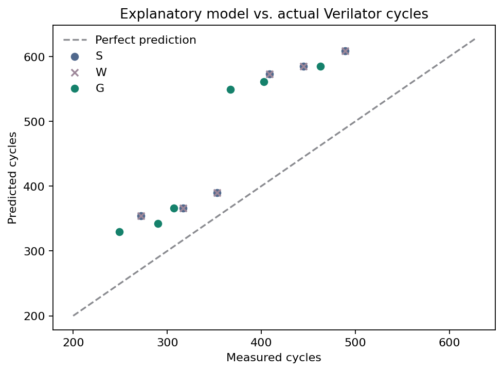
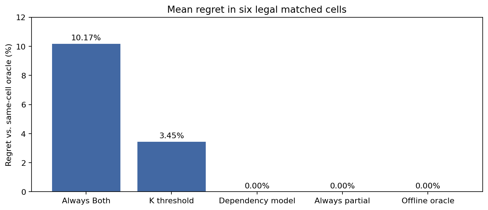

# 资源感知模型与策略评估

仅在 G 通过真实执行、golden 和配置快照后做该分析。校准取两个独立范围的 S、K16、seed 3、一趟记录。预测使用 K、固定两次 GEMM 的 tile 数、校准的 launch 至 await 间隔、G 相对 S 的编译后静态 `pilot_step` 指令数增量；测试周期在预测和选择之后才进入评分。固定阈值 K≥32、平局选择 S 与留出矩阵于提交 01e8266 固定。留出为 K16/32/64 × 两个范围，均 seed 11、三趟。重复运行不计为独立单元。[预先固定的配置](../../research/p1_criticalpath_pilot/configs/pilot_matrix.json) · [预测脚本](../../research/p1_criticalpath_pilot/scripts/evaluate_model.py)

S/W 估为 `trips × (serial_calibration + 2 × (K/8 − 2))`；G 另按每趟扣除受等待窗口限制、最多两周期的地址写开销，加上静态主函数指令增量。该模型是资源与依赖解释模型，对多趟稳态、不同代码布局和 DMA/barrier 相位没有单独项。18 个实际周期目标的 MAPE **27.18%**，校准的单趟成本按线性乘到三趟会高估本测试的运行时长。

| 策略 | 选对数 / 6 | 平均 regret | 最坏 regret | 相对 S 加速几何平均 | 相对最强固定 |
|---|---:|---:|---:|---:|---:|
| 原 whole-overlap | 0 | 10.17% | 14.98% | 1.0000× | 0.9080× |
| 总是 Dedup | 0 | 10.17% | 14.98% | 1.0000× | 0.9080× |
| 总是 Both | 0 | 10.17% | 14.98% | 1.0000× | 0.9080× |
| 阈值 K≥32 | 4 | 3.45% | 11.44% | 1.0658× | 0.9677× |
| 最少配置写、平局 S | 0 | 10.17% | 14.98% | 1.0000× | 0.9080× |
| 依赖模型 | 6 | 0% | 0% | 1.1013× | 1.0000× |
| 总是 G（合法时） | 6 | 0% | 0% | 1.1013× | 1.0000× |
| 离线 oracle | 6 | 0% | 0% | 1.1013× | 1.0000× |

regret = (选中实测 cycles − 同单元最优合法实测 cycles) / 最优合法实测 cycles。相对 S，八种策略最坏退化均为 0；以同单元固定 G 为参照，表中最坏 regret 直接给出最坏退化。固定 G 已在六格都取到最优。模型没有提高实际选择收益。原策略的 W 用实测，其余固定原策略复用字节等价的 CSR lowering。计数策略知道合法候选配置写数相同，不读取待测 trace。模型决策部分为 Python 微秒量级单次观测，仅计公式与选择，不含静态分析/I/O，未集成进 compiler，不能外推 pass 开销。

六格均来自同一构造族，且全部支持 G。当前样本不具备评价跨负载泛化的条件。模型表仅覆盖合法和正确的匹配负载。[逐项策略结果及决策耗时](data/policy_regret.csv) · [汇总](data/policy_summary.csv) · [预测与实测](data/model_predictions.csv)

