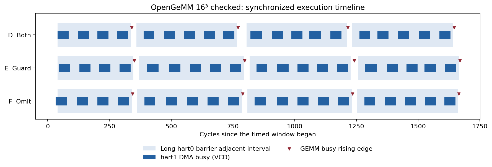
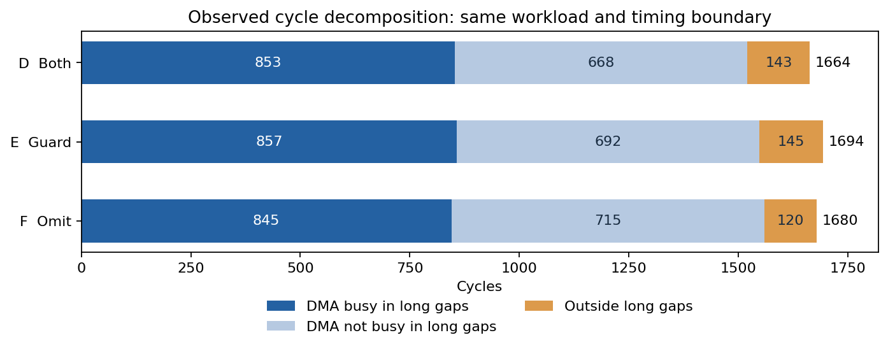
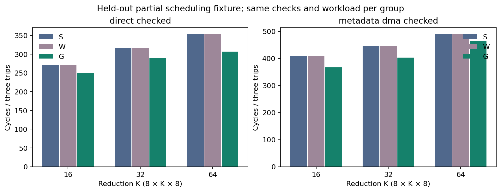
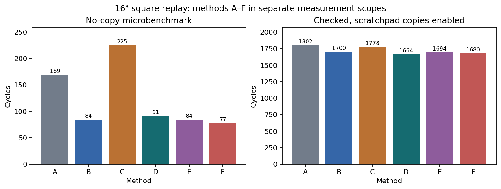
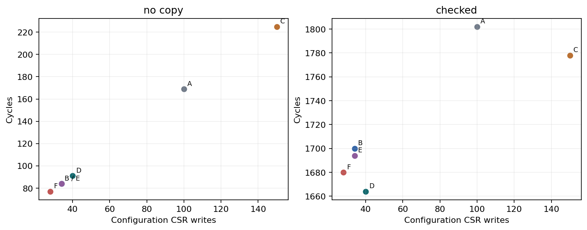
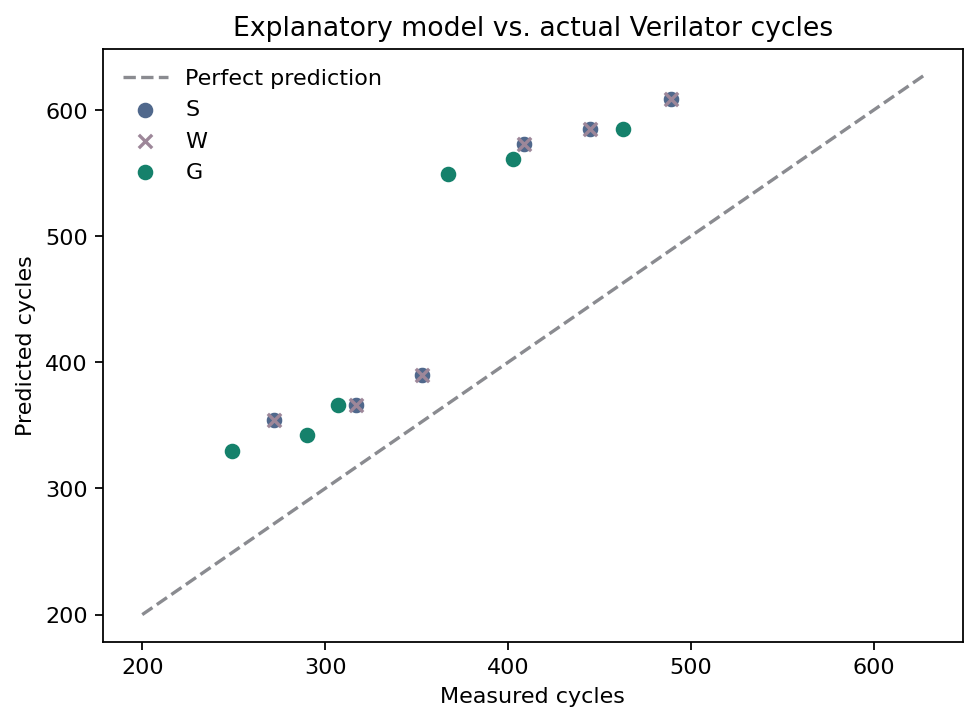
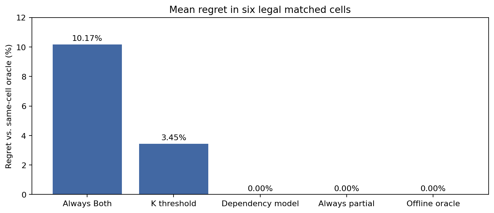

# P1 配置调度关键路径与受控优化报告

**研究判断为 CONDITIONAL。** 本试验确认 OpenGeMM 中配置写减少可以同时伴随执行周期增加。也构造出一个通过硬件状态、数值和时序验证的部分配置调度 G，在六个匹配的留出组合上减少 5.32%–13.03% 的 Verilator cycles。六格来自同一构造族，解释模型与固定 G 表现相同。证据支持继续验证字段级合法性与调度机制，当前不足以宣称通用优化或独立论文的有效性。

## 1. 目标及证据口径

《The Configuration Wall》将配置状态显式化，利用去重与整组配置重叠减少开销。P1 检验两个问题。第一，减少配置写在 checked 路径上为何能够增加总周期。第二，如果下一次 launch 中只有一个地址依赖真实执行结果，能否先写另外两个地址，并在保证 launch 读取相同配置的前提下缩短周期。[原论文](https://doi.org/10.1145/3760250.3762225)

| 标签 | 定义 |
|---|---|
| REFERENCE | 论文的 OpenGeMM 聚合加速比 1.99×、最大 2.71×，来自论文与验收对齐表。原复现值 1.98875×、2.71429× 属于 HISTORICAL。 |
| HISTORICAL | 已验收 PKL、旧诊断日志、旧双 hart trace 及其可核验计数，本次仅重读。 |
| NEW | 本次通过固定模拟器重新运行的方阵、波形重放及 G fixture。 |
| MODEL | 公式给出的周期估计。策略的实际效果用 NEW cycles 评分。 |

方阵 no-copy 中关闭 timed scratchpad 拷贝及输出校验。方阵 checked 包含相应拷贝、同步且验证 golden。新 fixture 的 direct 与 metadata DMA 两路均做 golden，后者计入每趟 4 字节 DMA 和两次 barrier。加速比和 regret 均在同一范围内计算。

## 2. 平台与复现保护

Intel Core i9-13900HX，Windows 11 + WSL2 Ubuntu 22.04，内核 6.18.58.1-microsoft-standard-WSL2，约 8 GiB RAM、4 GiB swap。Docker Desktop 29.9.3；镜像 `ghcr.io/kuleuven-micas/accfg-artifacts@sha256:a3dd42b69696b63e3c83a1a1719c0b2ae1965673d60251c468b337b3bf9ad813`。构建单 job、构建容器上限 3 GiB。采用已有 snitch_cluster.vlt，Verilator 5.026 v5.026-43-g065f36ab5，二进制 SHA-256 `39ab1f5e980f8afb7e8f018c5a8678f93c26be96bff717af834c0223af7b29d9`。MLIR/Clang 17.0.6，xDSL `791e89d87cc23303e9ce3ac2d7e48e25eecc0e03`。RISC-V GCC 13.2.0 和 Spike 1.1.1-dev 在镜像中，P1 执行周期来自 Verilator。主机分析用 Python 3.10.12、pandas 2.2.2、Matplotlib 3.10.9。Git 2.34.1、gh 2.4.0。

| Git 对象 | 固定 SHA |
|---|---|
| 起点与 repro/accfg-2026 | cbf660f1cc73dfffd589541c9c382b346a7206fd |
| main / paper-original | ce1567e40962037cda59a236bea6e3458caeb63a |
| snax-mlir | 0df8b515768232036bceb6af7a6d5935b5e1a3db |
| gemmini-rocc-tests | 4fec505cadacec4c371305b90973fa18758e9ac0 |
| riscv-tests | c84daca8824635b7d896003c78f9c6245997cf7a |
| riscv-tests/env | 0666378f353599d01fc48562b431b1dd049faab5 |
| rocc-software | fddb795a0b52e82f8f4ce9ead9b1428440a62ab0 |

研究工作树为 `/home/yanmo/research/projects/accfg-p1-pilot`。研究分支 `research/p1-criticalpath-pilot` 跟踪个人 fork 的同名 origin 分支。五个子模块的目标与实际 SHA 一致。官方原两份 PKL、Figure 10–12、原实验配置及验收运行日志的 SHA-256 核验通过。未提交的上一轮研究目录另有压缩备份，备份内每个文件与原 checkout 一致。原仓库 tracked 文件与 gitlink 无改动，整套原论文 benchmark 未重跑。[固定版本和文件哈希](../../research/p1_criticalpath_pilot/configs/frozen_baseline.json) · [原复现复核记录](logs/baseline_preservation.txt)

## 3. 原始方法、旧数据与新运行

A 为 Base，B 为 Dedup，C 为 Overlap，D 为 Both，E/F 为已有手工 Guard/Omit，G 为本次部分配置。旧证据的 28 组 cycles、配置写和 hart0 区间指令与本次 28 组一一相等。下表为 NEW cycles，可在旧证据表逐行交叉核对。no-copy 的最快是区间计时比较，正确性指标与 regret 为 N/A。

| 原方阵 | Scope | A | B | C | D | E | F | G |
|---|---|---:|---:|---:|---:|---:|---:|---:|
| 16³ | no-copy | 169 | 84 | 225 | 91 | 84 | 77 | N/A |
| 16³ | checked | 1802 | 1700 | 1778 | 1664 | 1694 | 1680 | N/A |
| 32³ | no-copy | 608 | 251 | 671 | 224 | N/A | N/A | N/A |
| 32³ | checked | 11985 | 11758 | 11882 | 11545 | N/A | N/A | N/A |
| 64³ | no-copy | 2624 | 1136 | 2352 | 968 | N/A | N/A | N/A |
| 64³ | checked | 85195 | 83424 | 84294 | 83460 | N/A | N/A | N/A |

16³ 从 no-copy 的 F 最快变为 checked 的 D 最快。32³ 两范围均 D 最快。64³ 从 no-copy 的 D 变为 checked 的 B，B 比 D 少 36 cycles。以下是 16³ 最主要反转的完整对照字段。其余单元同字段见附表。

| Matrix_Size | Scope | Method | Correctness | Cycles | CSR_Writes | Host_Instructions | Speedup_vs_Base | Speedup_vs_Both | Regret | Evidence |
|---|---|---|---|---:|---:|---:|---:|---:|---:|---|
| 16³ | no-copy | D | 未校验 | 91 | 40 | 62 | 1.857× | 1.000× | N/A | NEW |
| 16³ | no-copy | E | 未校验 | 84 | 34 | 56 | 2.012× | 1.083× | N/A | NEW |
| 16³ | no-copy | F | 未校验 | 77 | 28 | 50 | 2.195× | 1.182× | N/A | NEW |
| 16³ | checked | D | golden | 1664 | 40 | 86 | 1.083× | 1.000× | 0.000% | NEW |
| 16³ | checked | E | golden | 1694 | 34 | 80 | 1.064× | 0.982× | 1.803% | NEW |
| 16³ | checked | F | golden | 1680 | 28 | 74 | 1.073× | 0.990× | 0.962% | NEW |

[统一对比 CSV](data/performance_comparison.csv) · [历史结果及哈希](data/baseline_comparison.csv) · [方阵新运行及退出码](data/new_square_replays.csv) · [原复现论文数值对齐表](https://github.com/vihuyluong60685-jpg/accfg-artifacts/blob/repro/accfg-2026/reports/tables/paper_alignment.csv)

## 4. 性能反转定位

历史双 hart 事件重新解码得到四段长 barrier 邻近间隔 D/E/F 为 **1521/1549/1560 cycles**。同一 ELF 的有波形与无波形版本周期和定时区间相同。以下波形分解取 hart1 DMA busy 实际信号，依 hart0 mcycle 对齐。

| 16³ checked | DMA busy 在间隔内 | DMA 非 busy 在间隔内 | 四段之外 | 合计 |
|---|---:|---:|---:|---:|
| D | 853 | 668 | 143 | 1664 |
| E | 857 | 692 | 145 | 1694 |
| F | 845 | 715 | 120 | 1680 |

F 在同步间隔外省 23，间隔内增 39；其中 busy 减 8，非 busy 增 47。E 的间隔净增 28，分别是 busy 增 4、非 busy 增 24；外部增 2。运行顺序、配置状态与 DMA 完成证据确立了差异的位置。bank 冲突、请求前备址、前端停顿等具体机制尚无独立因果证据。指令 gap 覆盖同步、软件和硬件的共同时间，完整事件关键路径仍有未观测边。事件表标明 MEASURED、DERIVED、INFERRED、UNKNOWN。[事件边和证据](data/event_dependencies.csv) · [波形分解](data/wave_dma_breakdown.csv) · [分析](analysis/02_event_trace_analysis.md)

## 5. G 调度及 matched 性能

每趟执行两个真实 8×K×8 GEMM。第一次的输出 int32 决定第二次的 B 地址。G 仅在第一 launch 接受初始配置后提前写 A/C staging，保留 await、真实数据读取及 B 写的顺序。含 DMA 的版本先等 hart1 busy 解除并完成发布 barrier，随后 hart0 读取复制字。当前编译器的 whole-overlap 遇到产出 B 的有副作用调用而保留整组。匹配串行 S 和实际原 whole-overlap W 在该 fixture 上同周期、同 lowered IR；原 Base/Dedup/Both 的 lowering 也等价。E/F 在此 fixture 不适用，G 在原方阵未运行。

44 次 successful probe 各自有 Verilator 退出 0、golden 错误 0、最终配置读回错误 0，trace 比对 86 对 launch 快照。零趟没有配置写和 launch，两个范围都保留初始状态；一趟与三趟、三个输入种子覆盖两种 B 地址，验证最终一轮和软件可见状态。一个 G DMA 波形证明第一次 GEMM 处于 busy 的 21061–21064，A/C staging 在 21062/21063 更新，DMA 非 busy 后的读在 21138，B staging 在 21148 更新。25 个以上周期收益的单元不代表至少同样长的写重叠窗口，后端动态指令也变化。

| Matrix_Size | Scope | S = W cycles | G cycles | CSR_Writes 每方法 | Host_Instructions S/W → G | G 相对 S/W |
|---|---|---:|---:|---:|---:|---:|
| 8×16×8 | direct checked | 272 | 249 | 18 | 148 → 130 | 1.092× |
| 8×16×8 | metadata DMA checked | 409 | 367 | 18 | 172 → 154 | 1.114× |
| 8×32×8 | direct checked | 317 | 290 | 18 | 154 → 136 | 1.093× |
| 8×32×8 | metadata DMA checked | 445 | 403 | 18 | 178 → 160 | 1.104× |
| 8×64×8 | direct checked | 353 | 307 | 18 | 151 → 133 | 1.150× |
| 8×64×8 | metadata DMA checked | 489 | 463 | 18 | 175 → 157 | 1.056× |

均为 NEW、三趟、seed 11、golden+liveout+launch-snapshots PASS。每方法六次 launch 和 await，G 每格 regret 为 0。与匹配的原策略等价 lowering 相比平均加速 1.1013×（几何平均）。零趟平局，已测非零趟无负优化。收益归属完整重排和它生成的 ELF，其中动态 hart0 指令每三趟少 18，早写单独贡献待消融。K64 首轮的设备端参考计算超时，重试采用预生成独立 arrays，三种方法校验口径相同；链接布局可能变化。[探针数据及 SHA](data/partial_comparison.csv) · [快照和顺序](data/partial_launch_snapshots.csv) · [合法性](04_partial_schedule_correctness.md)

## 6. 解释模型与止损

模型使用独立的一趟 K16 串行校准、任务规模、静态指令差异和两次 staging 早写预算。实测留出周期仅用于评分。原固定、始终 Dedup/Both、配置写数最少策略各选对 0/6，平均 regret 10.17%、最坏 14.98%。K≥32 固定阈值为 4/6、3.45%、11.44%。依赖模型、始终 G 和离线 oracle 均 6/6、均值及最坏 regret 0。以最强固定 G 为参照，模型加速 **1.000×**，实际策略未改善。周期平均绝对百分比误差 **27.18%**，窗口与资源模型缺少多趟和同步相位成本。[策略评分](data/policy_summary.csv) · [模型评估](06_cost_model_assessment.md)

该机制相对 The Configuration Wall 的已验证差异，是在设备状态允许时分开同一组配置字段的完成时间。Autocomp 覆盖自动调度搜索，P1 在固定目标上给出字段 capture 与跨 hart 发布验证。AIDG 已有硬件依赖图与时间模型，通用 MLIR 软件流水和常规 List Scheduling 也有成熟重排技术。独立论文的潜在贡献须来自可复用的设备状态与发布约束、自动合法变换、代表性负载上的实测增量。当前可以撰写 pilot 与方法草稿，独立论文还需要跨负载与消融证据。[Autocomp](https://arxiv.org/abs/2505.18574) · [AIDG](https://doi.org/10.1145/3715122) · [MLIR LoopPipelining](https://github.com/llvm/llvm-project/blob/main/mlir/lib/Dialect/SCF/Transforms/LoopPipelining.cpp)

优先在 `compiler/transforms/accfg_config_overlap.py` 引入按字段划分可移动性，在 `compiler/accelerators/snax_gemm.py` 声明可独立写、捕获点与所有权。最小算法只生成一个已证合法 early/late 候选，用 launch 快照与 live-out 作回归；未知写者、副作用、reset、别名及原子写包保留原调度。先验证实际多算子生产消费链、无可用重叠窗口的负控制、不同 DMA 压力和同指令/布局消融。按条件分支、循环尾和拒绝路径扩展正确性集。只有在固定 G 不再处处最优且新模型能改善实际策略选择时，才继续花成本建模。[审稿式结论及下一步](07_reviewer_style_conclusion.md)

## 7. 运行与归档

| 实际运行 | 状态 |
|---|---|
| 28 个新原方阵、44 个 probe、三个 VCD 对照的无波形复跑 | Verilator 全部退出 0。六个同 ELF probe 复跑包括在 44 中。 |
| D/E/F 与一个 G 的四次波形复跑 | Verilator 及 FIFO decoder 均退出 0；定时区间逐一保持相同。 |
| 初始有限 VCD 探测 | 文件上限 64 MiB，记录退出 153，后续用 FIFO 成功取信号。 |
| 首轮 K64 S/W direct | 均退出 124，发生在计时区间后。K64 G 旧批次没有保留退出码。改用预生成 golden 后六组退出 0。 |
| 早期 ABI 链接与 lowering 诊断 | 链接器退出 1，修正 C wrapper 名称。初始 lowering 有输入、输出同名造成的解析失败，未保留首个数值退出码；修正后策略 lowering 校验完成。 |

数据、脚本、报告和七张 PNG 均在研究分支。大型双 hart trace、波形中间产物、详细日志及保留的 ELF 存在工作树 `research/p1_criticalpath_pilot/local/`，另有同本地文件系统的压缩副本。副本内 1136 个文件的长度和哈希逐一与清单匹配。远程分支保存清单和小型结果。K64 首轮、波形探测限额和两项工具失败的记录均保留。[逐次退出码与日志索引](manifests/run_status.csv) · [本地文件 SHA-256](manifests/local_artifacts_sha256.csv) · [本地压缩归档](manifests/local_archive.json) · [报告数据与图表 SHA-256](manifests/report_evidence_sha256.csv) · [复跑入口](../../research/p1_criticalpath_pilot/README.md)
