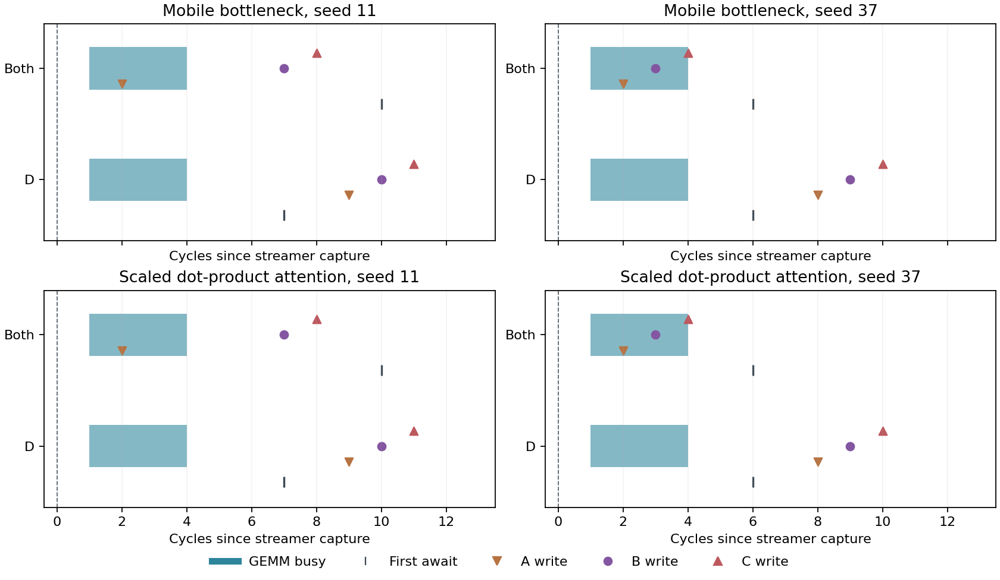

# 字段级配置机会与关键路径证据

诊断工具直接解析固定 xDSL ACCFG，运行 verifier，匹配 setup 状态链、首个 launch 与 await。在 Dedup 产物上按字段追踪 SSA 所有者及相对位置，保留实际 Base 字段和 Both 调度作为交叉检查。对于间隔中的调用，按具体被验证的效果契约保守分析。未修改编译器算法。[诊断源码](../../research/p1_workload_gate/scripts/opportunities.py) · [字段 CSV](data/field_opportunities.csv) · [调用与证据 JSON](data/static_decisions.json)

| 指标 | 分母 | 结果 |
|---|---|---|
| 至少一字段可安全提前 | 两个实际的跨 launch 静态位置 | 2/2 |
| 部分字段早、其余字段有真实晚到依赖 | 同上 | 0/2 |
| Dedup 后三个独立指针可安全提前 | 两位置共六个变化字段 | 6/6 |
| Both 漏掉的合法位置和字段 | 同一批位置、字段 | 0/2、0/6 |
| 从安全延迟起单独加一字段有端到端收益 | 四种图×输入组合的 12 个字段实例 | 6/12，每次 1 周期 |
| 任意部分提前是否优于 Both | 四格各有六种真子集 | 0/24 优于；12/24 持平、12/24 慢 1–2 周期 |

原每次 launch 有 25 个配置字段，第二次 Dedup 去除 22 个不变的 shape/stride/模式写，留下 A/B/C。可提前是**地址值**，真实张量仍在 await 后生成或变换，第二次 launch 等到数据发布。三个地址在 OpenGeMM 属于独立 staging CSR。其它 22 个字段在本实验中的值固定，未据此推断其独立调度合法性。对原子组合、跨设备所有权、未知 CSR 观察等，缺条件时应保留串行。

波形在每次首个 streamer ready/valid 交接与 busy 上升对齐，GEMM config-valid/busy 与 staging 更新分别时间戳化。首次 GEMM busy 均为 **3 cycles**；Both 的 A 在全部四格位于 busy 中，B 仅在 seed 37 的两格位于 busy 中，C 均在 busy 外。相同布局的 D 直到 await 后才改三项。两条图中 seed 11 的 C 与 D 到达主机算子起点时周期相同，端到端完全持平；seed 37，三写跨 await 合计省 3 周期。**位于 busy 内和实际消除端到端等待是两个不同观测。** 整段初始配置至首次 launch 为约 29–45 周期，其中还包含普通指令和 launch，该实验未隔离其内部逐条关键性。Both 的配置 CSR 占 hart0 动态指令约 **0.58%–0.87%**；实测可追回的端到端比例最高 **0.0451%**。[硬件窗口](data/hardware_windows.csv) · [边际干预](data/field_marginals.csv) · [软件阶段](data/execution_phases.csv)

第二阶段历史校准可找回真实晚到 A、可提前 B/C，原整组拒绝，原因是字段生产链的 effectful call；所有字段晚到时释放候选为零。隐藏 staging 观察或未知外部调用，诊断默认保守拒绝，也对新图进行撤销摘要的安全检查。官方 pass 对新图生成 whole overlap 的事实与此保守门槛分列，不能外推到未审计的调用。[静态位置分组](data/opportunity_sites.csv)

