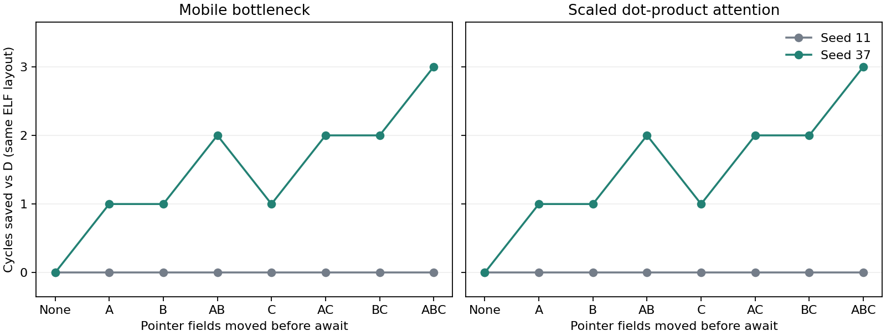

# 合法调度枚举与经验上界

| 策略 | 可执行定义 |
|---|---|
| A | 固定项目 Base lowering，两次 setup 各 25 写 |
| B | 同 IR 加原始 `accfg-dedup`，净 28 写 |
| C | 原始 Dedup 后运行原始 whole-overlap，28 写，三个变化字段均提前 |
| D | 保守基线，三字段均在第一次 await 后、主机 helper 前配置。与 C 同一链接布局，也称 mask 0 |
| E | 对两图各穷举 1–6 六个非空真子集，每图在两输入平均加速内选最优可执行子集。A/B 提前的 mask 3 与最优并列，按编号打破平局 |
| F | 冻结时声明的简单静态读端策略 A/B 提前而 C 延后，复用 mask 3 实测。当前没有针对该直线外部 helper 的独立通用软件流水对照 |

D、C 是 0、7 两个端点。全部 8 种位置已实际通过正确性。所有候选都只在首个 await 周围重排三个 staging 字段，launch、宿主算子及其它控制流保持，不把任意时序预测混入实测。Oracle1 在同布局 8 mask 中逐组合取最小周期，用于估计早写可获得的上界。Oracle2 可在 Base、Dedup、Both 和所有合法 mask 中逐组合取最小，用于测试策略选择的价值。上界只覆盖已枚举空间；额外指令重排、不同布局、跨图或重叠 DMA 未测试。没有使用理想时序 MODEL 来计算收益。[逐输入 oracle](data/schedule_oracle.csv) · [所有八种时序](data/layout_grid.csv)

| 图/seed | A | B | C | D | E | F | 同布局最佳 | 全集合最佳 |
|---|---:|---:|---:|---:|---:|---:|---:|---:|
| Mobile / 11 | 9312 | 9246 | 9218 | 9218 | 9218 | 9218 | 9218 | 9218（C 同分） |
| Mobile / 37 | 9071 | 8986 | 8959 | 8962 | 8960 | 8960 | 8959 | 8959（C） |
| Attention / 11 | 6746 | 6688 | 6678 | 6678 | 6678 | 6678 | 6678 | 6678（C 同分） |
| Attention / 37 | 6717 | 6608 | 6656 | 6659 | 6657 | 6657 | 6656 | 6608（B） |

E 从 D 最多追回 **2 周期**。同布局最佳为 0 或 3 周期，总体 C 已达到四格的同布局最优。全集合 oracle 多出的空间全部来自 attention seed 37 的现有 Dedup 策略；候选与最优的差异不要解释为字段级算法遗漏。

