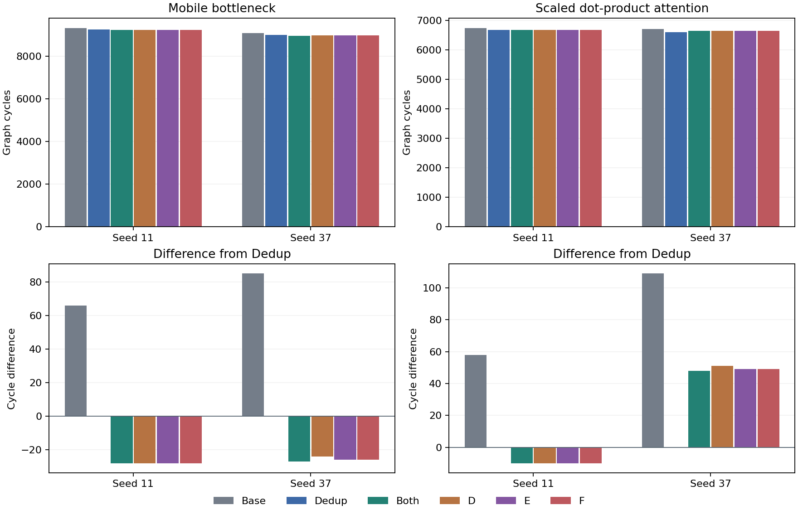

# 端到端图延迟与固定策略距离

图端到端范围从第一次 mcycle 读取后开始打包原始输入和权重，包含两轮配置与执行、主机算子、最后量化/残差与输出落地，在第二次 mcycle 边界结束。golden 和 CSR 最终检查在区间外。两条图使用同一边界，两个种子是不同输入且复用同一个 ELF。该区间不包括系统加载模型、网络、数据集、模型外算子或端到端应用响应。[范围定义](01_workload_selection.md) · [逐次数据](data/performance.csv)

| 对比 | 四格 | 解释 |
|---|---|---|
| C 相对 A | 几何平均 **1.01051×** | 同时包含去掉重复配置和 lowering/布局、整组早写的影响 |
| 同布局 C 相对 D | **0、3、0、3 cycles** | 最大 **0.0451%**；两输入之一的两图均持平 |
| 可执行真子集 E 相对 D | **0、2、0、2 cycles** | 最大约 **0.0300%**；其余两格无收益 |
| 全集合 oracle 相对最强固定 C | 几何平均 **1.00181×** | C 三格取优，Attention seed 37 由 B 再省 48 周期 |
| 固定 B 相对 oracle | 最坏 regret **0.304%** | 几何平均相对 Base **1.01043×**，比 C 的最坏 regret 低 |

Attention seed 37 中 Both 比 Dedup **慢 48 周期**（6656 vs 6608），虽然同布局 C 比 D 快 3。差异跨越两个独立编译 ELF，现有证据不把它归给配置早写本身。严格真子集对 D 没有负优化，但相对同布局的 C，24 组里 12 组慢 1–2 周期。全局最优和固定 C 的最坏差距以 regret `(固定−最优)/最优` 计算为 **0.726%**，没有以未验证模型做估计。

构造族第二阶段的严格 0.11%–0.16% 与本阶段最大 0.0451% 均为各自定时范围内的实测。两条新图中输入/权重打包约 2900 周期，Mobile 的宿主中间部分约 4200–4400，Attention 的约 2250–2290。只有个别段的三个周期能被移动，远低于这些段。未发现新负载具备更明显的稳定系统级收益。[固定策略分数](data/policies.csv) · [阶段周期](data/execution_phases.csv)

